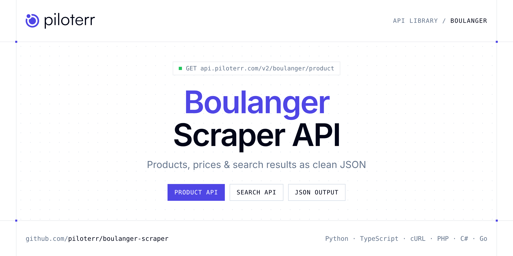

<p align="center">
  <a href="https://www.piloterr.com"></a>
</p>

# Boulanger Scraper API

[](https://discord.gg/CFj3ph8aHU) [](https://app.piloterr.com) [](https://app.piloterr.com/openapi) [](LICENSE)

The **Piloterr Boulanger Scraper API** lets you extract public data from Boulanger as **clean, structured JSON** — no proxies, headless browsers or HTML parsing to maintain. Endpoints available in production:

- **Boulanger Product API** — Read one Boulanger product from its URL or product id.
- **Boulanger Search API** — Search Boulanger by keyword and page the product grid.

Use it for price monitoring, assortment tracking, competitor analysis, product research or catalog enrichment.

| Endpoint | Path | Credits | What you get |
|---|---|---|---|
| [Boulanger Product API](#boulanger-product-api) | `/v2/boulanger/product` | 2 | Read one Boulanger product from its URL or product id. You get price, brand, rating, seller, and specifications. |
| [Boulanger Search API](#boulanger-search-api) | `/v2/boulanger/search` | 2 | Search Boulanger by keyword and page the product grid. Cards include price, brand, seller, and the product URL. |

## Table of contents

- [How it works](#how-it-works)
- [Boulanger Product API](#boulanger-product-api)
- [Boulanger Search API](#boulanger-search-api)
- [Code examples in other languages](#code-examples-in-other-languages)
- [Practical use cases](#practical-use-cases)
- [Why Piloterr?](#why-piloterr)
- [FAQ](#faq)
- [Related scrapers](#related-scrapers)
- [Support](#support)

## How it works

1. **Create a free Piloterr account** and copy your API key from the [dashboard](https://app.piloterr.com).
2. **Send a `GET` (or `POST`) request** to `https://api.piloterr.com/v2/...` with the header `x-api-key: YOUR_API_KEY`.
3. **Receive structured JSON** — Piloterr handles rendering, proxies, retries and parsing.

```bash
export PILOTERR_API_KEY="your-api-key"
pip install requests        # Python
# TypeScript: Node.js 18+ (native fetch), run with `npx tsx file.ts`
```

> Every endpoint accepts both `GET` (query string) and `POST` (JSON body with the same fields).

## Boulanger Product API

Read one Boulanger product from its URL or product id. You get price, brand, rating, seller, and specifications.

`GET | POST https://api.piloterr.com/v2/boulanger/product` · **2 credits per request** · [Full reference](https://app.piloterr.com/openapi)

### Request parameters

| Parameter | Type | Required | Description |
|---|---|---|---|
| `query` | string | ✅ | Product URL /ref/{id}, or the numeric product id. |
| `return_page_source` | boolean | — | When true, returns the raw HTML instead of the parsed JSON. The response shape is {"result": "<html>..."}. Default false. |

### Python example

```python
import json
import os
import requests

response = requests.get(
    "https://api.piloterr.com/v2/boulanger/product",
    headers={"x-api-key": os.environ["PILOTERR_API_KEY"]},
    params={
        "query": "https://www.boulanger.com/ref/1193303",
    },
    timeout=60,
)
response.raise_for_status()
data = response.json()

print(json.dumps(data, indent=2, ensure_ascii=False)[:2000])
```

### TypeScript example

```typescript
type BoulangerProduct = {
  sku?: string;
  url?: string;
  gtin?: string;
  name?: string;
  brand?: string;
  color?: unknown;
  image?: string;
  price?: number;
  images?: string[];
  rating?: number;
  seller?: string;
  eco_tax?: number;
  reviews?: {
    date?: string;
    text?: string;
    title?: string;
    author?: string;
    rating?: number;
  }[];
  currency?: string;
  warranty?: string;
  condition?: string;
  highlight?: string;
  was_price?: number;
  categories?: string[];
  product_id?: string;
  description?: string;
  return_days?: number;
  return_fees?: string;
  seller_note?: string;
  availability?: string;
  [key: string]: unknown;
};

const params = new URLSearchParams({
  "query": "https://www.boulanger.com/ref/1193303",
});

const response = await fetch(`https://api.piloterr.com/v2/boulanger/product?${params}`, {
  headers: { "x-api-key": process.env.PILOTERR_API_KEY! },
});
if (!response.ok) throw new Error(`Piloterr error ${response.status}: ${await response.text()}`);

const data = (await response.json()) as BoulangerProduct;

console.log(JSON.stringify(data, null, 2).slice(0, 2000));
```

<details>
<summary><b>POST variant</b></summary>

```http
POST https://api.piloterr.com/v2/boulanger/product
x-api-key: YOUR_API_KEY
Content-Type: application/json

{"query": "https://www.boulanger.com/ref/1193303"}
```
</details>

### Output example

Example response from the API reference, abridged — real values depend on the page you scrape.

```json
{
  "sku": "790955ea-031f-4c6a-a06d-a9bdeedec70c",
  "url": "https://www.boulanger.com/ref/1193303",
  "gtin": "5025155081754",
  "name": "Aspirateur balai DYSON V15 Detect Absolute",
  "brand": "DYSON",
  "color": null,
  "image": "https://boulanger.scene7.com/is/image/Boulanger/5025155081754_h_f_l_0",
  "price": 709.29,
  "images": [
    "https://boulanger.scene7.com/is/image/Boulanger/5025155081754_h_f_l_0",
    "https://boulanger.scene7.com/is/image/Boulanger/5025155081754_h_f_l_1"
  ],
  "rating": 4.7,
  "seller": "example",
  "eco_tax": 1.2,
  "reviews": [
    {
      "date": "2026-10-19",
      "text": "Tres bon produit, puissant et silencieux, avec une très bonne autonomie de presque 1 heure !! la 2eme brosse avec le laser ... pas vraime…",
      "title": "DYSON V15",
      "author": "example",
      "rating": 5
    },
    {
      "date": "2026-10-05",
      "text": "Très puissant.\\nVraiment top\\nC'est mon quatrième dyson et celui-ci dépasse tous les autres",
      "title": "Aspirateur Dyson",
      "author": "example",
      "rating": 5
    }
  ],
  "currency": "EUR",
  "warranty": "Garantie légale : 2 ans",
  "condition": "neuf",
  "highlight": "Sa lumière révèle les particules invisibles à l'oeil nu ! Fourni avec 4 accessoires",
  "was_price": 799,
  "categories": [
    "Maison - Entretien - Jardin",
    "Aspirateur"
  ],
  "product_id": "1193303",
  "description": "Toute l'innovation Dyson se retrouve dans l'aspirateur-balai V15 Detect Absolute : performance, hygiène et puissance sont les mots-clés d…",
  "return_days": 15,
  "return_fees": "free",
  "seller_note": "Les délais de livraisons peuvent être allongés en période de soldes et de fin d'année.",
  "availability": "in_stock"
}
```

### Response fields

| Field | Type | Description |
|---|---|---|
| `sku` | string |  |
| `url` | string |  |
| `gtin` | string |  |
| `name` | string |  |
| `brand` | string |  |
| `color` | object |  |
| `image` | string |  |
| `price` | number |  |
| `images` | string[] |  |
| `rating` | number |  |
| `seller` | string |  |
| `eco_tax` | number |  |
| `reviews[]` | object[] |  |
| `reviews[].date` | string |  |
| `reviews[].text` | string |  |
| `reviews[].title` | string |  |
| `reviews[].author` | string |  |
| `reviews[].rating` | integer |  |
| `currency` | string |  |
| `warranty` | string |  |
| `condition` | string |  |
| `highlight` | string |  |
| `was_price` | integer |  |
| `categories` | string[] |  |
| `product_id` | string |  |

## Boulanger Search API

Search Boulanger by keyword and page the product grid. Cards include price, brand, seller, and the product URL.

`GET | POST https://api.piloterr.com/v2/boulanger/search` · **2 credits per request** · [Full reference](https://app.piloterr.com/openapi)

### Request parameters

| Parameter | Type | Required | Description |
|---|---|---|---|
| `query` | string | ✅ | Keyword, a Boulanger /resultats URL, or a /c/ category URL. |
| `page` | number | — | Page number, from 1. Default is 1. Page 2 is sent as numPage=2 and returns different product ids. |
| `return_page_source` | boolean | — | When true, returns the raw HTML instead of the parsed JSON. The response shape is {"result": "<html>..."}. Default false. |

### Python example

```python
import json
import os
import requests

response = requests.get(
    "https://api.piloterr.com/v2/boulanger/search",
    headers={"x-api-key": os.environ["PILOTERR_API_KEY"]},
    params={
        "query": "aspirateur",
    },
    timeout=60,
)
response.raise_for_status()
data = response.json()

print(json.dumps(data, indent=2, ensure_ascii=False)[:2000])
```

### TypeScript example

```typescript
type BoulangerSearch = {
  results?: {
    url?: string;
    name?: string;
    brand?: string;
    color?: unknown;
    image?: string;
    price?: number;
    rating?: unknown;
    seller?: string;
    eco_tax?: unknown;
    currency?: string;
    in_stock?: boolean;
    offer_id?: string;
    position?: number;
    condition?: string;
    highlight?: string;
    was_price?: number;
    key_points?: string[];
    product_id?: string;
    review_count?: unknown;
    price_display?: string;
    eco_tax_display?: unknown;
    discount_display?: string;
    installment_cost?: unknown;
    installment_count?: unknown;
    installment_price?: unknown;
    [key: string]: unknown;
  }[];
  pagination?: {
    next?: string;
    page?: number;
    per_page?: number;
    total_pages?: number;
    total_results?: number;
  };
};

const params = new URLSearchParams({
  "query": "aspirateur",
});

const response = await fetch(`https://api.piloterr.com/v2/boulanger/search?${params}`, {
  headers: { "x-api-key": process.env.PILOTERR_API_KEY! },
});
if (!response.ok) throw new Error(`Piloterr error ${response.status}: ${await response.text()}`);

const data = (await response.json()) as BoulangerSearch;

console.log(JSON.stringify(data, null, 2).slice(0, 2000));
```

<details>
<summary><b>POST variant</b></summary>

```http
POST https://api.piloterr.com/v2/boulanger/search
x-api-key: YOUR_API_KEY
Content-Type: application/json

{"query": "aspirateur"}
```
</details>

### Output example

Example response from the API reference, abridged — real values depend on the page you scrape.

```json
{
  "results": [
    {
      "url": "https://www.boulanger.com/ref/9000978984",
      "name": "Aspirateur balai VACTIDY V10 PRO",
      "brand": "VACTIDY",
      "color": null,
      "image": "https://boulanger.scene7.com/is/image/Boulanger/6924843236393_h_f_l_0",
      "price": 66.99,
      "rating": null,
      "seller": "example",
      "eco_tax": null,
      "currency": "EUR",
      "in_stock": true,
      "offer_id": "86dc761c-d394-4c82-bb0d-345b89258dd7",
      "position": 1,
      "condition": "neuf",
      "highlight": "Le design moderne rose et le format sans fil léger apportent une touche de plaisir au quotidien, pour un nettoyage simple et fluide.",
      "was_price": 89.99,
      "key_points": [
        "Temps de charge : 4 h, Autonomie : 45 mn, Poids : 2,2 kg",
        "Tube pliable : Non concerné"
      ],
      "product_id": "9000978984",
      "review_count": null,
      "price_display": "66,99 €",
      "eco_tax_display": null,
      "discount_display": "-25%",
      "installment_cost": null,
      "installment_count": null,
      "installment_price": null
    }
  ],
  "pagination": {
    "next": "https://www.boulanger.com/resultats?tr=aspirateur&numPage=2",
    "page": 1,
    "per_page": 40,
    "total_pages": 23,
    "total_results": 916
  }
}
```

### Response fields

| Field | Type | Description |
|---|---|---|
| `results[]` | object[] |  |
| `results[].url` | string |  |
| `results[].name` | string |  |
| `results[].brand` | string |  |
| `results[].color` | object |  |
| `results[].image` | string |  |
| `results[].price` | number |  |
| `results[].rating` | object |  |
| `results[].seller` | string |  |
| `results[].eco_tax` | object |  |
| `results[].currency` | string |  |
| `results[].in_stock` | boolean |  |
| `results[].offer_id` | string |  |
| `results[].position` | integer |  |
| `results[].condition` | string |  |
| `results[].highlight` | string |  |
| `results[].was_price` | number |  |
| `results[].key_points` | string[] |  |
| `results[].product_id` | string |  |
| `results[].review_count` | object |  |
| `results[].price_display` | string |  |
| `results[].eco_tax_display` | object |  |
| `results[].discount_display` | string |  |
| `results[].installment_cost` | object |  |
| `results[].installment_count` | object |  |

## Code examples in other languages

Ready-to-run examples live in the [`examples/`](examples) folder. Each one reads your key from the `PILOTERR_API_KEY` environment variable.

| Language | Product | Search |
|---|---|---|
| cURL (Bash) | [`product`](examples/curl/product.sh) | [`search`](examples/curl/search.sh) |
| PHP | [`product`](examples/php/product.php) | [`search`](examples/php/search.php) |
| C# | [`product`](examples/csharp/Product.cs) | [`search`](examples/csharp/Search.cs) |
| Go | [`product`](examples/go/product.go) | [`search`](examples/go/search.go) |
| Java | [`product`](examples/java/ProductExample.java) | [`search`](examples/java/SearchExample.java) |
| Ruby | [`product`](examples/ruby/product.rb) | [`search`](examples/ruby/search.rb) |
| Node.js | [`product`](examples/nodejs/product.mjs) | [`search`](examples/nodejs/search.mjs) |

## Practical use cases

- **Price monitoring** — Track prices, promotions and availability over time to react to competitors.
- **Assortment & catalog tracking** — Follow new products, delisted items and category changes.
- **Competitor analysis** — Benchmark ranges, brands and positioning across retailers.
- **Product research** — Spot best-sellers and trends from search results.
- **Catalog enrichment** — Pull titles, images and attributes into your PIM or marketplace listings.

## Why Piloterr?

- **No infrastructure** — no proxies, headless browsers or CAPTCHA solving to run yourself.
- **Structured JSON** — stable, documented fields instead of brittle HTML selectors.
- **Pay per request** — transparent credit cost per endpoint, failed requests are retried for you.
- **One API key, hundreds of sources** — Boulanger plus many other e-commerce, search and company data endpoints in the [Piloterr library](https://www.piloterr.com/library).
- **Any language** — plain HTTPS + JSON, with examples for Python, TypeScript, cURL, PHP, C#, Go, Java, Ruby and Node.js.

## FAQ

### Is it legal to scrape Boulanger?

Collecting publicly available data is generally allowed in many jurisdictions, but rules depend on your country, the data you collect and how you use it. Avoid personal data unless you have a lawful basis, respect the website's terms where they apply, and get legal advice for your specific use case. This is not legal advice.

### Do I need proxies or a headless browser?

No. Piloterr handles rendering, proxy rotation and retries on its side. You only send an HTTPS request with your `x-api-key` header and receive JSON.

### How much does a request cost?

Credits per call: `/v2/boulanger/product` **2**, `/v2/boulanger/search` **2**. See the [Piloterr website](https://www.piloterr.com) for plans.

### What data does the Boulanger API return?

Each endpoint returns structured JSON: **Boulanger Product** — `sku`, `url`, `gtin`, `name`, `brand`, `color`; **Boulanger Search** — `results[]`, `results[].url`, `results[].name`, `results[].brand`, `results[].color`, `results[].image`.

### How do I paginate Boulanger results?

Use the `page` parameter and keep requesting while the response indicates more results.

### Can I get the raw HTML instead of JSON?

Yes. Set `return_page_source=true` and the response becomes `{"result": "..."}` with the page source.

### Which languages are supported?

Any language that can make an HTTP request. This README shows Python and TypeScript; the [`examples/`](examples) folder contains cURL, PHP, C#, Go, Java, Ruby and Node.js.

## Related scrapers

- [About You Scraper API](https://github.com/piloterr/aboutyou-scraper)
- [Action Scraper API](https://github.com/piloterr/action-scraper)
- [Aldi Scraper API](https://github.com/piloterr/aldi-scraper)
- [Alibaba Scraper API](https://github.com/piloterr/alibaba-scraper)
- [AliExpress Scraper API](https://github.com/piloterr/aliexpress-scraper)
- [Allegro Scraper API](https://github.com/piloterr/allegro-scraper)
- [All Piloterr scrapers on GitHub](https://github.com/piloterr)

## Support

- 💬 Join the [Piloterr Discord](https://discord.gg/CFj3ph8aHU) to ask questions and share what you build.
- 📚 Browse the [API reference (OpenAPI)](https://app.piloterr.com/openapi) and the [Piloterr library](https://www.piloterr.com/library).
- 🔑 [Get your API key](https://app.piloterr.com).

---

<p align="center">
  <a href="https://www.piloterr.com">
    <picture>
      <source media="(prefers-color-scheme: dark)" srcset="images/logo-dark.svg">
      
    </picture>
  </a>
  <br>
  <sub>Built by <a href="https://www.piloterr.com">Piloterr</a> — web scraping APIs for e-commerce, search, real estate and more, one API key.</sub>
</p>

<sub>Boulanger is a trademark of its respective owner. This repository is not affiliated with or endorsed by Boulanger. Examples are released under the MIT license.</sub>
